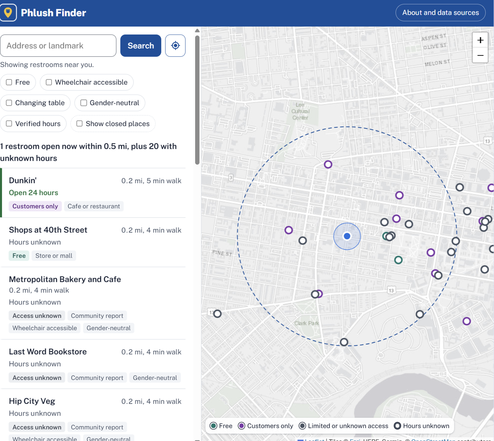
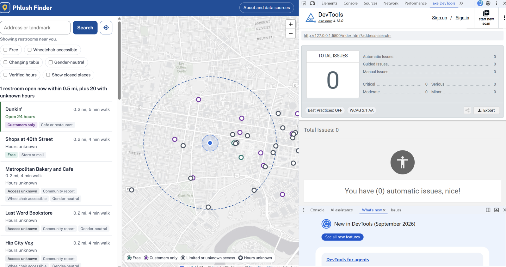

# Phlush Finder

**Find a restroom in Philadelphia that is open right now.**

Phlush Finder is a decision support tool for people who are out in the city and need a restroom quickly. It starts at your location, lists the nearest restrooms that are open at this moment, and tells you whether you can use each one for free and whether it has the facilities you need.

**Live site: https://ivydudl338-dotcom.github.io/dashboard-project/**



By Ou Du, for the Weitzman MUSA JavaScript course, Fall 2026.

---

## Users and decisions

**The users I want to empower are** people who are out and about in Philadelphia and suddenly need a restroom: tourists, delivery and gig workers, parents with young children, people with disabilities, and people with medical conditions (such as IBD) that make bathroom access urgent.

**The specific decisions those users need to make are:**

1. **Where should I go right now?** Which nearby restroom is open at this moment, and how far is it?
2. **Can I use it?** Is it free and open to the public, or do I need to buy something first?
3. **Does it meet my needs?** Is it wheelchair accessible, does it have a baby changing table, is it gender-neutral?

**The data required to inform these decisions is:**

- **Locations** of restrooms, from the City of Philadelphia, Visit Philly, the Free Library of Philadelphia, OpenStreetMap, and Refuge Restrooms.
- **Opening hours** for each location, so the tool can tell whether it is open now.
- **Access type**: free and public, or customers only.
- **Amenities**: wheelchair accessibility, changing tables, gender-neutral facilities.
- **Data confidence**: whether the information is officially verified or community-reported, and when it was last updated.

## How the tool supports each decision

| Decision | What the tool does |
|---|---|
| Where should I go right now? | Starts at your location (or an address you search, with suggestions as you type) and lists restrooms within 0.5 miles, **open ones first**, nearest first, with walking time. Each row says "Open until 6 PM" or warns when a place closes within 30 minutes. Status refreshes every minute. Drag the map to search another area. |
| Can I use it? | Markers are colored by access: **teal = free**, **violet = customers only**, **gray = limited or unknown**. A **Free** filter hides places that require a purchase. Popups include tips such as "ask staff for the door code". |
| Does it meet my needs? | Filters for **wheelchair accessible**, **changing table**, and **gender-neutral**. |
| Can I trust this? | **Filled** markers have known hours, **hollow** markers don't. A **Verified hours** filter keeps only hours checked against official sources. Every popup names its source and when it was last updated. |

Things I left out on purpose because they don't help with these decisions: ratings and reviews, crowd estimates (no reliable data), and in-app turn-by-turn navigation (the popup links to walking directions in Google Maps instead).

## Data sources

| Source | What it provides | Places |
|---|---|---|
| City of Philadelphia, [Philly Phlush public restrooms](https://www.phila.gov/publicrestrooms) | Locations, hours, and amenities of the three city-run public restrooms (checked October 21, 2026) | 3 |
| Visit Philly, [Public restrooms in Philadelphia](https://www.visitphilly.com/articles/philadelphia/public-restrooms/) | Free restrooms at transit stations, visitor centers, markets, malls, and parks (article updated January 28, 2026) | 21 |
| Free Library of Philadelphia, [branch pages](https://libwww.freelibrary.org/locations/) | Weekly hours, restroom and accessible-entrance listings for each open branch (checked October 21, 2026) | 51 |
| City of Philadelphia, [City Facilities (Master Facilities Database)](https://opendataphilly.org/datasets/city-facilities-master-facilities-database/) via OpenDataPhilly | Coordinates for library branches | |
| © [OpenStreetMap contributors](https://www.openstreetmap.org/copyright), ODbL, exported with [Overpass Turbo](https://overpass-turbo.eu/) | Public toilets, malls, supermarkets, department stores, chain cafes and restaurants, with opening hours (exported October 21, 2026) | about 520 |
| [Refuge Restrooms](https://www.refugerestrooms.org/) API | Community reports, many of them gender-neutral or accessible restrooms (retrieved October 21, 2026) | about 250 |
| [U.S. Census Bureau Geocoder](https://geocoding.geo.census.gov/) | Coordinates for Visit Philly and Philly Phlush addresses (used during data preparation) | |

The app also uses [Photon](https://photon.komoot.io/) by komoot (OpenStreetMap data) for address search, and the [Esri Light Gray Canvas](https://server.arcgisonline.com/ArcGIS/rest/services/Canvas/World_Light_Gray_Base/MapServer) basemap (Esri, HERE, Garmin, © OpenStreetMap contributors). All sources are also cited in the **About and data sources** dialog in the app.

### How the data was prepared

`scripts/build-data.mjs` turns the raw files in `data/raw/` into `data/restrooms.geojson` (853 places, about 350 KB). The main rules:

- **Takeout-only chains are left out** (for example Domino's, Little Caesars, Philly Pretzel Factory), because they usually have no customer restroom. Other chain cafes and restaurants are kept as "customers only".
- **Stores where restrooms are often staff-only** (for example Aldi, Trader Joe's, Ross) are kept, with a note to ask staff.
- **Duplicates are merged.** Men's and women's rooms mapped separately become one place; OpenStreetMap toilets at a site already on an official list are dropped; a Refuge report at a place we already have becomes a "community tip" on that place.
- **The airport is one point.** Dozens of restrooms inside the terminals at Philadelphia International Airport are combined into a single marker marked "limited access".
- **Closed library branches are excluded** (three branches were temporarily closed in October 2026).
- **Opening hours** use the OpenStreetMap `opening_hours` format. `js/opening-hours.js` parses them (including hours past midnight) for both the build script and the app. Holiday exceptions are ignored.

### Limitations

- OpenStreetMap and Refuge Restrooms are maintained by volunteers. Some places may have closed or changed their policies. Refuge reports in particular can be several years old, so the app shows each report's date.
- Most cafes and restaurants are assumed to have a customer restroom based on the type of business, not a confirmed listing.
- The Refuge snapshot covers about 2.4 miles around City Hall plus a citywide text search. Run `node scripts/fetch-refuge.mjs` to download all Philadelphia records.
- Five Visit Philly sites (such as Lloyd Hall and Cherry Street Pier) have approximate map locations because the geocoder couldn't match their addresses.

## Accessibility and responsiveness

- Scanned with **axe DevTools** (axe-core 4.13, WCAG 2.1 AA): **0 issues**. I also scanned with the search suggestions, a map popup, and the About dialog open, at desktop and phone widths, and found no issues.
- Every control has a label, keyboard focus is clearly visible, the search suggestions follow the ARIA combobox pattern (arrow keys, Enter, Escape), and a "skip to the list" link is the first thing on the page. Restroom names from community data are inserted as text, never as HTML.
- Tested at 320, 390, 768, 1280, and 1920 pixels wide. On phones the map sits above the list; on wider screens they sit side by side.



## Technical details

```
index.html             Page structure and the About dialog (data citations)
css/styles.css         All styles; layout switches from stacked to side by side at 900px
js/main.js             App state, rendering, search, filters, and selection
js/map.js              Leaflet map, basemap, and marker styles
js/details.js          List rows and map popups
js/format.js           Times, distances, and opening status in plain words
js/opening-hours.js    Parser for OpenStreetMap-style opening hours (shared with the build script)
js/search.js           Address search with Photon
js/autocomplete.js     Accessible search-as-you-type dropdown
data/restrooms.geojson The data the app loads
data/raw/              Source files used to build it
scripts/               Data build and refresh scripts (Node.js, no dependencies)
docs/                  Screenshots for this README
```

- Built with plain HTML, CSS, and JavaScript modules, plus [Leaflet](https://leafletjs.com/) 1.9.4. There is no build step for the website.
- **Run it locally:** JavaScript modules don't load from `file://`, so serve the folder, for example with VS Code's Live Server extension or `npx http-server`, then open `index.html`.
- **Rebuild the data:** `node scripts/build-data.mjs`
- **Lint:** `npm install`, then `npm run js-lint` and `npm run css-lint`. The GitHub Actions workflows in `.github/workflows/` run both linters on every push and deploy the site to GitHub Pages.

## Related project

[PHLASK](https://technical.ly/civics/philadelphia-public-restroom-phlask/), a Code for Philly project, maps water, food, and bathrooms in Philadelphia. Phlush Finder focuses on one decision, whether a restroom is open and usable right now.

## Disclaimer

Phlush Finder is a student project and is not affiliated with the City of Philadelphia's Philly Phlush program. Hours and access policies change, so check with the place when it matters.
